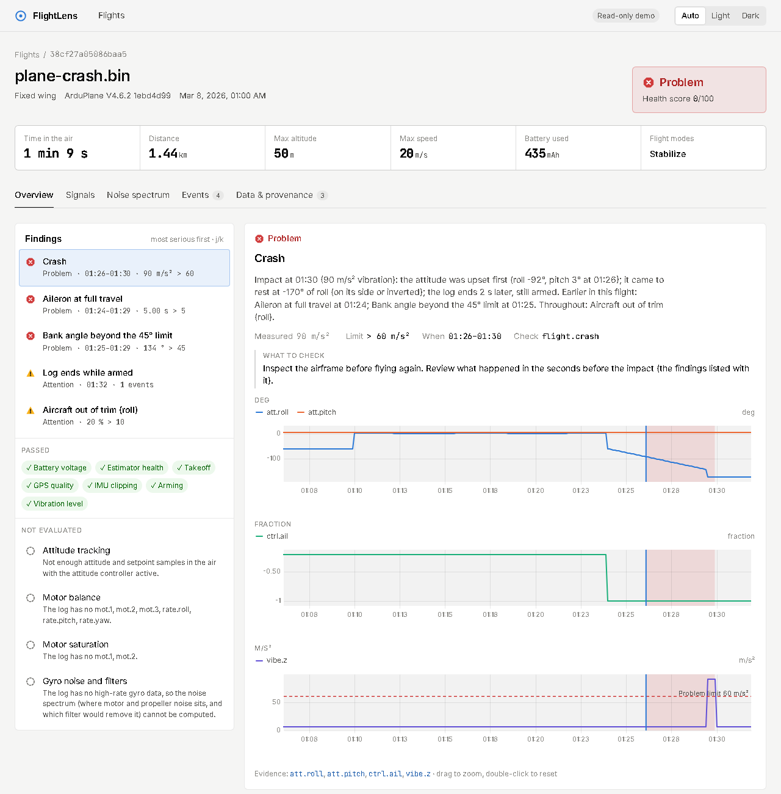
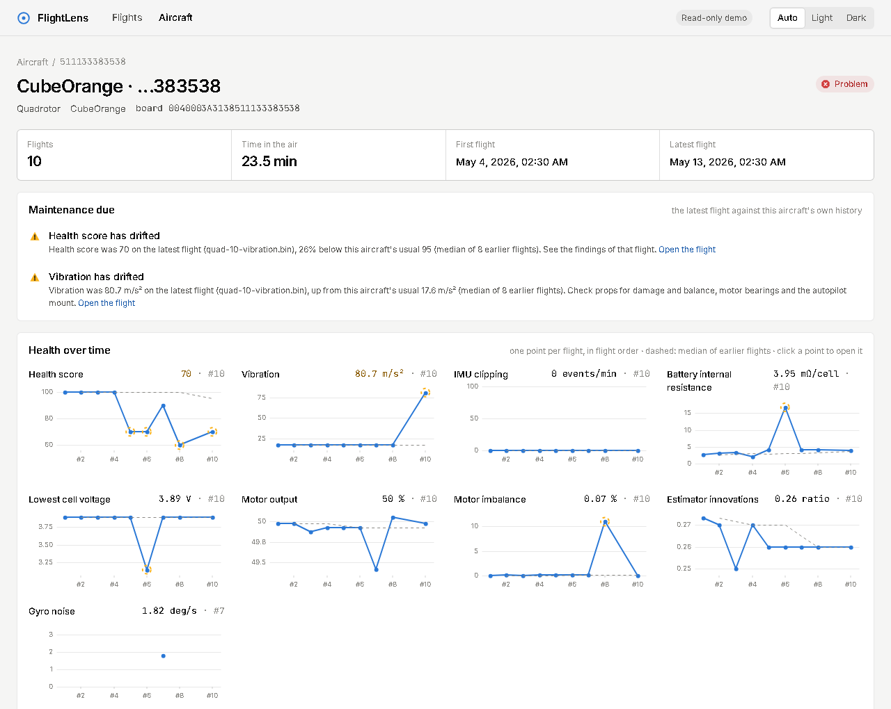
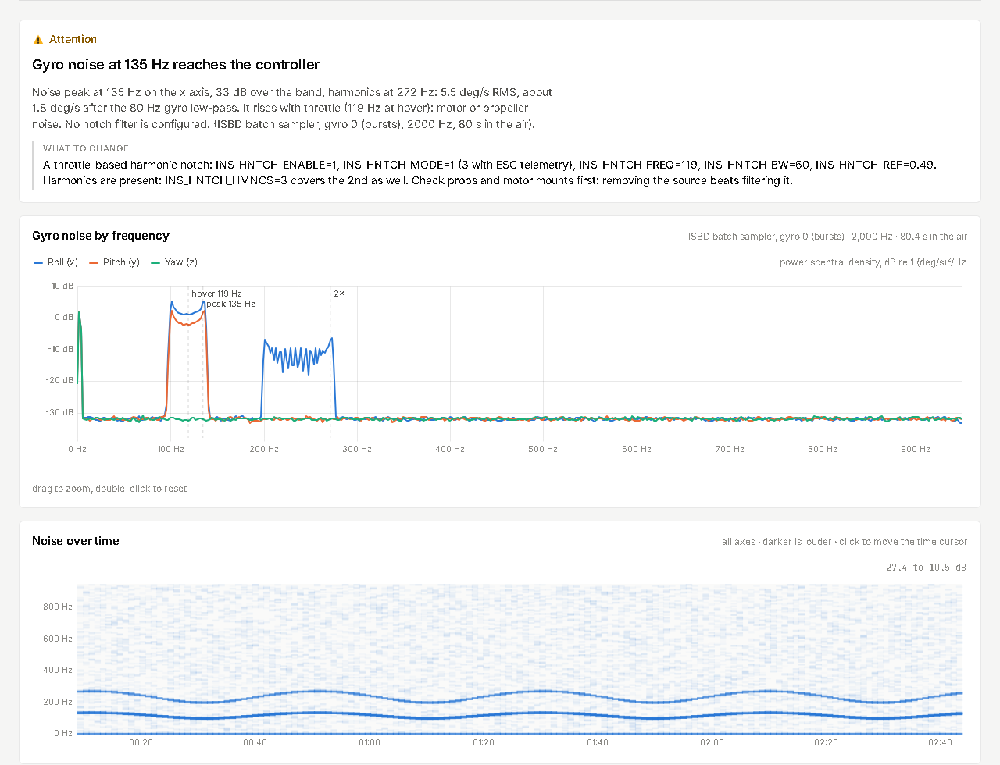

# FlightLens

FlightLens reads a drone flight log after landing and tells you whether the aircraft is healthy, what went wrong, when it happened and what to fix first. Everything runs on your own machine; logs are never sent anywhere.

```
$ flightlens analyze 9c90f86e.ulg
FlightLens 1.1.0 · PX4 v1.14.4 · Hexarotor · 22:12
0.31 km · max alt 4 m · max speed 3.1 m/s · 24367 mAh used · Stabilized, Position
Verdict: PROBLEM   (health score 10/100)

✖ Problem    Accelerometer clipping          00:54–21:32  27,935 events > 100
✖ Problem    Vibration too high (worst IMU)  09:46–09:50  43.4 m/s² > 30
✖ Problem    Battery voltage sagged          19:44–22:11  3.20 V/cell < 3.30
✔ OK         Attitude tracking, Estimator health, Errors and failsafes, GPS quality, ...
```

**Status:** PX4 `.ulg`, ArduPilot `.bin` and MAVLink telemetry `.tlog` logs (from either firmware, as Mission Planner or QGroundControl record them) are supported end to end (CLI, web app, Docker), with the same checks and report for all. Validated on 28 real public PX4 logs, 15 real ArduPlane logs, 8 PX4 SITL sessions and a 54-log fault benchmark ([docs/validation.md](docs/validation.md)).



| Health over time, per aircraft | Gyro noise and notch-filter advice |
|---|---|
|  |  |

*Screenshots from `flightlens demo` (generated flights, one known fault each).*

## Run it

**Try it on example flights** (Python 3.12+; the web UI is included):

```bash
pip install flightlens            # once released; from source: see below
flightlens demo                   # example flights at http://localhost:8000
```

**With Docker**:

```bash
docker compose up -d --build
```

Open http://localhost:8000 and drop `.ulg` files onto the page. Flights are stored in the `flightlens-data` Docker volume and survive restarts. The port is bound to this computer only, and the server only answers to `localhost`. To share it on your network, see `docker-compose.yml` (or run `flightlens serve --host 0.0.0.0 --allow-host <your-ip>`).

**Without Docker** (Python 3.12+, [uv](https://docs.astral.sh/uv/), Node 20+):

```bash
uv sync
cd web && npm ci && npm run build && cd ..
uv run flightlens serve          # http://localhost:8000, data in ./data
```

## Commands

| Command | What it does |
|---|---|
| `flightlens analyze <log> [--json out.json] [--html out.html]` | Prints the verdict and findings; `--html` writes a self-contained report (print it to save a PDF) |
| `flightlens batch <folder> [--csv out.csv]` | Analyzes every log in a folder and summarizes the results |
| `flightlens signals <log>` | Lists every signal found, with its source topic and rate |
| `flightlens replay-info flight.ulg` | What a replay of the log contains: rate, data sources, gaps |
| `flightlens serve [--workers N] [--log-format json]` | Starts the web app and API; health at `/api/health`, Prometheus metrics at `/metrics` |
| `flightlens demo [--read-only]` | Generates example flights with known faults and opens them in the web app |
| `flightlens checks` | Lists the checks, their signals and default thresholds |
| `flightlens validate <manifest or folder>` | Scores FlightLens against labelled logs: per-check recall, precision, false alarms; exit 1 if any log is wrong |
| `flightlens backup lib.zip [--no-analysis]` | Backs up the library (database, original logs, results); safe while the server runs |
| `flightlens restore lib.zip --data newdir` | Restores a backup into a new folder, checking every log's SHA-256 |
| `flightlens prune --older-than 365 [--yes]` | Lists flights older than N days, keeps reviewed ones; deletes only with `--yes` |
| `flightlens reviews export --data data --out reviews.yaml` | Exports engineer reviews of findings as a validation manifest for `flightlens validate` |
| `flightlens profile learn <folder> --name N --out N.yaml` | Learns attention thresholds from one aircraft's own flights; use the file with `--profile` on `analyze`, `batch` and `validate` |

Exit codes for `analyze` (for CI): `0` healthy · `1` attention · `2` problem · `3` insufficient data or unreadable log · `64` bad arguments.

## What it checks

| Check | PX4 source | ArduPilot source | Notes |
|---|---|---|---|
| Vibration level | `accel_vibration_metric` (worst IMU) | `VIBE.VibeX/Y/Z` (worst IMU) | PX4 20 / 30 m/s² held 3 s (set from real logs); ArduPilot 30 / 60 m/s² (ArduPilot guidance) |
| IMU clipping | `accel_clipping` | `VIBE.Clip` (all IMUs) | any / > 100 events while armed |
| Attitude tracking | attitude vs setpoint quaternions | `ATT` Roll vs DesRoll, … | only in the air and in attitude-controlled modes |
| GPS quality | satellites, HDOP, fix | `GPS.NSats/HDop/Status` | not evaluated if GPS never had a fix (indoor, vision) |
| Battery voltage | `battery_status` | `BAT.Volt` | volts per cell; on ArduPilot the cell count comes from `MOT_BAT_VOLT_MAX` or, if unambiguous, the resting voltage |
| Motor saturation | `actuator_motors` | `RCOU` via `SERVOn_FUNCTION` | lift motors above 95%; VTOL pushers excluded |
| Motor balance | mean motor output in steady hover | same | needs 10 s of hover |
| Estimator health | `estimator_status` test ratios | `XKF4`/`NKF4` SV, SP, SH, SM | 1.0 = test failed on both; heading ignored 10 s after takeoff |
| Errors and failsafes | failsafe flags, failure detector, messages | `ERR` failsafes, crash and thrust-loss checks | only in flight |
| **Crash or hard landing** | attitude, end of log | `VIBE` impact, `STAT.Crash`, attitude | lists what went wrong earlier in the same flight as likely causes |
| **Takeoff** | altitude vs thrust and mode | altitude vs throttle and mode | thrust commanded but the aircraft never climbed 1 m |
| **Arming** | "Preflight Fail" messages | "PreArm:" messages | why the aircraft never armed |
| **Attitude limits** | `FW_R_LIM`, `MPC_TILTMAX_AIR` | `ROLL_LIMIT_DEG`, `ANGLE_MAX` | bank or pitch beyond the aircraft's own configured limit |
| **Control surface travel** | — | `AETR` aileron, elevator | at full travel: no control authority left (fixed wing) |
| **Trim** | — | `AETR` aileron in level flight | aileron needed to fly wings-level (fixed wing) |
| **Rate-loop tuning** | `vehicle_rates_setpoint` vs angular velocity | `RATE` (Copter), `PIDR/PIDP` target vs actual (Plane) | step response estimated from normal flying (as in PID-Analyzer): overshoot, falls short, does not follow, sluggish; judged only when the estimate is reliable. Step-response plot in the UI |
| **Autopilot power** | `system_power.voltage5v_v` | `POWR.Vcc` | 5 V rail below 4.5 V in the air (brown-out risk) |
| **Battery reserve** | `battery_status.remaining` | `BAT.RemPct` | left at landing below 20%; ignored when the estimate follows voltage sag, not charge used |
| **Compass interference** | magnetometer vs `battery_status.current_a` | `MAG` vs `BAT.Curr` | field the power wiring adds at full current, against the Earth's field (compassmot's limits) |
| **Estimator lane switches** | `estimator_selector_status` | `XKF4.PI` | the flight controller changed estimator (IMU) in flight |
| **RC link** | `input_rc.rc_lost` | (failsafe events) | RC signal lost in the air |
| **ESC telemetry** | `esc_status` | `ESC` | ESC above 90 / 110 °C; a motor commanded to spin that turns at under 20% of the others (desync, failed ESC); telemetry of zeros is not evaluated |
| **Barometer** | `vehicle_air_data.baro_alt_meter` | `BARO` (both instances) | height drift between takeoff and landing against GPS at rest (4 / 8 m); two barometers that disagree (5 / 10 m) |
| **Wind** | `wind` | `XKF2.VWN/VWE` | estimated wind above 10 m/s over 10 s (Attention only: a condition, not a fault); impacts left out |
| **Gyro noise and filters** | raw gyro `sensor_gyro_fifo` (or `sensor_combined`) | batch sampler `ISBH/ISBD` or `GYR` | a noise peak that gets past the low-pass with no notch covering it; gives `INS_HNTCH_*` / `IMU_GYRO_*` values, and tells motor noise (follows throttle) from frame resonance. Spectrum and spectrogram in the UI |

Checks only judge time **in the air**: armed, not landed (land detector, or ArduPlane `STAT.isFlying`), and in an armed period whose altitude actually changed. Short impact spikes (touchdown, crash) are reported by the crash check, not as vibration or clipping. On fixed wing, yaw is never tracked (there is no yaw setpoint), and an axis whose setpoint never changes is skipped.

Thresholds are community starting values, not limits approved for your aircraft. A **threshold profile** replaces them for one aircraft: written by hand, or learned from its own healthy flights (Aircraft page, or `flightlens profile learn`). Learned values only ever tighten or loosen *attention* levels, never reach the problem level, and every report records the profile it used. Two flights can be overlaid on the same signals, aligned at takeoff, on the Compare page.

## Validation

Every claim is checked against logs with a known outcome, using one label format (a YAML *manifest*: which findings each log must and must not produce, with time windows; see [validate.py](src/flightlens/validate.py)):

| Set | Logs | Result |
|---|---|---|
| Fault benchmark (generated, one injected fault each, healthy flights near every limit) | 54 (5 as telemetry logs) | 54 fully correct, 25 checks, 0 false alarms: [docs/validation.md](docs/validation.md) |
| Real ArduPlane crashes (owner's logs, not committed) | 15 | crashes and hard landings found with causes: [docs/real-log-results.md](docs/real-log-results.md) |
| PX4 SITL sessions that never flew | 8 | arming refusals and failed takeoffs explained |
| Public PX4 logs (Flight Review) | 28 | calibration set for the thresholds |

The benchmark runs in CI, so a threshold or logic regression fails the build. It proves the detection logic against modelled fault signatures; realism comes from the real logs and from SITL fault injection (`scripts/sitl_campaign.py`, Linux or WSL with a built ArduPilot tree). `flightlens signals <log>` shows which fields a log provided.

## How it works

```
.ulg / .bin / .tlog  →  parser + versioned mapping table  →  common data model  →  checks  →  findings  →  verdict
```

- **Telemetry logs** (`.tlog`) are what the ground station received over the radio, usually at 1-10 Hz with dropouts: the checks that work on such data run (vibration, battery, GPS, estimator, failsafes, crash, arming...), the ones that need the onboard log's high-rate data (noise spectrum, rate-loop tuning) say so. FlightLens decodes MAVLink itself; its message definitions are tested against pymavlink.
- **Common data model** ([model.py](src/flightlens/model.py)): signals named in one vocabulary (`vibe.metric`, `bat.volt`, …), events, parameters, armed segments and data-quality issues. Firmware-specific names live only in [mappings/px4.yaml](src/flightlens/parsers/mappings/px4.yaml) and [mappings/ardupilot.yaml](src/flightlens/parsers/mappings/ardupilot.yaml).
- **Honest results:** a check without data is *not evaluated*, never OK. A flight is called *healthy* only if at least 3 checks actually ran and it was armed for at least 10 s; otherwise the verdict is *insufficient data*.
- **Replay:** every analyzed flight plays back in 3D with flight instruments, a map and synced charts on one clock; every finding has "Replay from here" ([docs/replay.md](docs/replay.md)).
- **Isolation:** the web server parses each upload in a separate process with a time limit, so a broken file cannot take it down.
- **Operations:** a health check that Docker uses, Prometheus metrics, JSON logs with request ids, parallel analysis (`--workers`), and a graceful shutdown: running analyses get time to finish, and anything unfinished resumes at the next start instead of being lost.
- **Traceability:** reports record the FlightLens version, each check's version, the mapping version, the threshold profile and the log's SHA-256. Original files are kept unchanged. After an upgrade, flights analyzed by an older check or mapping are marked *outdated*, with the reason, and can be re-analyzed in one click.
- **Reports and review:** every flight has a printable, self-contained HTML report (evidence charts, provenance; print to PDF). An engineer can mark each finding *confirmed*, *false alarm* or *accepted* with a note; reviews never change the automatic verdict, appear in the report, and export as validation labels, so the next FlightLens version is tested against your own judgement.

See [docs/real-log-results.md](docs/real-log-results.md) for how the checks behave on 28 real public PX4 logs.

## Writing a check

```python
from flightlens.checks import register
from flightlens.model import CheckConfig, Finding, Flight, Severity


@register
class MyCheck:
    id = "my.check"
    title = "My check"
    version = "1.0.0"
    required_signals = ("bat.volt",)
    defaults = {"attention": 3.5, "problem": 3.3}

    def run(self, flight: Flight, config: CheckConfig) -> list[Finding]: ...
```

Drop the file in `src/flightlens/checks/`; it is discovered automatically. Add synthetic tests like [test_checks_m2.py](tests/test_checks_m2.py).

## Development

```bash
uv run pytest                                   # 429 tests (FLIGHTLENS_SLOW=1 adds a 100 MB test)
uv run ruff check . && uv run ruff format --check . && uv run mypy
cd web && npm run dev                           # UI with hot reload; run `uv run flightlens serve` alongside
uv run python scripts/fetch_px4_logs.py --count 20   # public test logs into testdata/real/
uv run flightlens batch testdata/real
uv run python scripts/benchmark.py              # regenerate docs/validation.md
uv run flightlens validate private-logs         # your own labelled logs (gitignored)
uv run python scripts/fuzz.py --iterations 20000 # long fuzz campaign against both parsers
```

## Documentation and releases

The documentation site (built from [docs/](docs/) with MkDocs, `uv run --group docs mkdocs serve`) covers getting started, how it works, the [check reference](docs/checks.md) generated from the code, validation and writing a check. Changes are listed in [CHANGELOG.md](CHANGELOG.md).

Releases are cut by pushing a tag `vX.Y.Z` that matches `pyproject.toml`: the [release workflow](.github/workflows/release.yml) tests, then publishes the wheel (with the web UI bundled) to PyPI, a `linux/amd64` + `linux/arm64` image to GHCR and a GitHub release. Build the same artifacts locally with `uv run python scripts/build_dist.py`.

## Known limits

- **No login.** Anyone who can reach the server can upload, change and delete
  flights. Keep it on `localhost` or a trusted network, or put it behind a
  reverse proxy with authentication; see [SECURITY.md](SECURITY.md).
- **Validation.** Every check is proven on the generated fault benchmark,
  which shows the detection logic works on faults *as modelled there*. Real
  logs are the real test: 28 public PX4 logs, 20 ArduPilot logs and 8 PX4 SITL
  sessions so far. The ArduPilot SITL fault campaign
  (`scripts/sitl_campaign.py`) has not been run yet. The ESC, barometer and
  wind checks have the least real data behind them (ESC telemetry from 5
  public PX4 logs; no real ArduPilot ESC data).
- **Thresholds** are community starting values, not limits approved for your
  aircraft; use a threshold profile to set your own.

## Contributing

See [CONTRIBUTING.md](CONTRIBUTING.md). Security problems: [SECURITY.md](SECURITY.md).

## Licence

MIT, see [LICENSE](LICENSE). Sample logs in `testdata/logs/` come from [PX4/pyulog](https://github.com/PX4/pyulog) (BSD-3-Clause).
