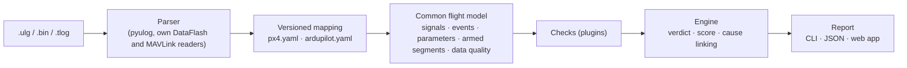

# How it works



- **One vocabulary for every firmware.** Parsers translate firmware fields into
  common signals (`vibe.z`, `bat.volt`, `att.roll`, `gyro.raw.x`…). Field names
  live only in the versioned mapping tables, so a firmware change is a mapping
  change, and every report records the mapping version.
- **Checks are plugins.** Each declares the signals it needs and its default
  thresholds, and returns findings with a severity, a time window, the measured
  value against the limit, an explanation, a recommendation and the evidence
  signals. See [Writing a check](writing-a-check.md).
- **Time in the air only.** Checks judge the time the aircraft was armed, not
  landed, and actually climbed. Short impacts are left to the crash check rather
  than counted as vibration or clipping.
- **Honest verdicts.** Missing data means *not evaluated*, never OK. A flight is
  *healthy* only when at least 3 checks ran and it was armed for at least 10 s;
  a log that never armed is *insufficient data*, with the reason.
- **Diagnosis.** For a crash, the engine attaches the other findings from the
  same flight before the impact (and standing conditions such as being out of
  trim) as likely causes.
- **Isolation.** The server analyzes each upload in a separate process with a
  time limit, so a damaged or hostile file cannot take it down. The API refuses
  unknown hosts (DNS rebinding), cross-site writes and oversized uploads.
- **Traceability.** Reports keep the FlightLens, check and mapping versions and
  the log's SHA-256; the original file is stored unchanged.

## Aircraft and trends

Flights from the same autopilot board are one aircraft until you name it; a
name given on the Aircraft page applies to every flight of that board, and new
flights from the board take it over. Each analyzed flight stores a small set of
[trend metrics](checks.md#trend-metrics-aircraft-pages). For every metric, a
flight is compared with the median of the same aircraft's earlier flights; it
is flagged only if it is worse by more than the metric's minimum change *and*
by more than the aircraft's own usual scatter, so a naturally variable aircraft
is not flagged for being itself. The latest flagged values are listed as
"maintenance due". Board ids only suggest identity (boards get swapped, some
report placeholder ids); a name you give always wins.


## Threshold profiles

The checks' defaults are community starting values. A *profile* replaces some
of them for one aircraft and is stored with a short digest of its values; every
report records the profile's name, source and digest, so a verdict can always be
traced to the thresholds that produced it. Changing an aircraft's profile
re-analyzes its flights.

```yaml
name: Quad-7
description: heavy-lift frame, stiffer mounts
checks:
  vibration.level: {attention: 25, problem: 45}
  battery.sag: {attention: 3.55}
```

A profile is refused if it names an unknown check or setting, or puts an
attention threshold beyond its problem threshold.

**Learned profiles.** FlightLens can learn *attention* thresholds from an
aircraft's own flights that had no Problem verdict (at least 4), using the
per-flight metric that measures the same quantity:

| Threshold | Learned from |
|---|---|
| `vibration.level` attention (`px4_attention` on PX4) | 95th percentile vibration in the air |
| `motor.imbalance` attention | motor spread in steady hover |
| `battery.sag` attention | 1st percentile volts per cell in the air |

The value is the aircraft's median plus the same margin the drift alerts use
(the larger of the metric's minimum change and 3 robust standard deviations).
It is then kept within a safe range: never tighter than half way from the
default to zero, and never closer than 10% to the default problem threshold.
Problem thresholds are never learned. A learned profile therefore notices when
*this* aircraft vibrates more than it usually does, long before the generic
limit, without ever hiding a real problem.

Learn one on the Aircraft page, or from the command line:

```bash
flightlens profile learn logs/quad7 --name Quad-7 --out quad7.yaml
flightlens analyze new-flight.bin --profile quad7.yaml
```

## Comparing flights

The Compare page overlays two flights on the signals they share, with time
measured from each flight's first takeoff (or arming, when no takeoff was
detected), next to the change in each health metric and which findings are new,
gone or present in both. Open it from two selected flights in the library, from
"Compare with #n" in an aircraft's flight list, or "Compare…" on a flight, which
picks the previous flight of the same aircraft.

## Telemetry logs

A `.tlog` is what a ground station (Mission Planner, QGroundControl,
MAVProxy) received over the telemetry radio: MAVLink messages at their stream
rates, usually 1-10 Hz, with whatever the radio lost. FlightLens reads it with
its own MAVLink decoder (versions 1 and 2, signed frames, damaged bytes
skipped), picks the vehicle among the senders (a tlog also holds the ground
station's own heartbeat and peripherals), and maps the messages to the same
signals as the onboard logs: attitude from `ATTITUDE`, position from
`GLOBAL_POSITION_INT`, battery from `SYS_STATUS`, vibration from `VIBRATION`,
estimator health from `EKF_STATUS_REPORT` (ArduPilot) or `ESTIMATOR_STATUS`
(PX4), arming and flight modes from `HEARTBEAT`, parameters from the download
the ground station made on connecting.

The same checks then run, on less data. Packets lost on the link are reported
from the gaps in MAVLink's sequence numbers. The noise spectrum and rate-loop
tuning need the onboard log's high-rate data and report that they cannot run;
on fixed wing, control-surface checks need the onboard `AETR` message.

## Rate-loop tuning

A flight never contains a clean step input, but every stick input and every
correction is an input to the rate controller, and the gyro shows its output.
Over two-second windows of flight, FlightLens estimates the controller's
response by regularised (Wiener) deconvolution of the measured rate by the
setpoint and integrates it into a step response; the median over all windows
is shown on the *Tuning* tab with the spread between windows.

An estimate is only judged when it is trustworthy: at least 20 windows with
stick or correction activity, and a setpoint that explains the measured rate
(coherence of at least 0.6 below 3 Hz). On simulated loops of known damping
the estimated peak is within 0.15 of the true one; on real 50 Hz logs, fewer
windows gave spurious peaks, which is why the gate exists. Yaw is shown but
not judged.

## Reports

Each flight has a printable report (the "Report" link on a flight, or
`flightlens analyze --html out.html`): verdict, every finding with its evidence
chart and the limit it crossed, the checks that ran and their versions, data
quality, engineer reviews and a provenance block (log SHA-256, FlightLens,
check and mapping versions, threshold profile). It is one HTML file with no
external resources, so it can be archived or emailed; print it from the browser
to save an A4 PDF.

## Outdated analyses

Every flight records the version of each check and of the signal mapping that
analyzed it. When FlightLens is upgraded and a check or mapping changes, the
flights it analyzed are marked *outdated*, with the reason (for example
`vibration.level 1.1.0 → 1.2.0`): their verdict may differ from what the
current version would say. The library offers to re-analyze all of them; a
flight's page offers to re-analyze it alone.

## Engineer review

An engineer can mark each Problem or Attention finding as *confirmed* (real),
*false alarm* (FlightLens was wrong) or *accepted* (real, but acceptable), with
a note. A review never changes the automatic verdict; it is shown next to the
finding and in the report. Reviews are keyed by the check and the finding's
start, so they survive re-analysis of the same log.

Reviews export as a [validation manifest](validation.md) ("Export reviews" in
the library, or `flightlens reviews export`): confirmed and accepted findings
become expected findings, false alarms become `must_not` rules. Run
`flightlens validate` on that file after an upgrade to see where the new
version disagrees with your engineers.

## Robustness

A flight log is untrusted input: it may be truncated by a crash, damaged on an
SD card, or crafted on purpose. For any file, the parsers either read it or
refuse it with a clear message; they never crash and never hang. This is
checked by fuzzing: valid logs are damaged in the ways real files get damaged
(cut off, bit flips, zeroed, duplicated or inserted blocks, corrupted message
definitions), and every damaged copy must be read or refused cleanly, with no
check crashing on what was read. A short version runs on every change
(`tests/test_fuzz.py`), a long campaign weekly (`scripts/fuzz.py`); each input
that ever broke a parser is kept as a regression test.

What survives damage is reported, not hidden: a skipped message type, a topic
without timestamps or an unreadable parameter appears under *Data &
provenance*. The web server also parses every upload in a separate process with
a time limit, so even an unknown failure cannot take it down.

## Storage

| What | Where |
|---|---|
| Flight index, jobs, aircraft names, trend metrics, threshold profiles, reviews, analysis versions | SQLite (`data/flightlens.db`), migrated in place on upgrade |
| Original logs | `data/flights/<id>/`, unchanged |
| Signals | one Parquet file per signal, zstd |
| Report, spectrum | JSON next to the signals |
