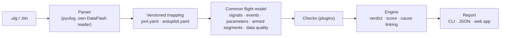

# How it works

- **One vocabulary for every firmware.** Parsers translate firmware fields into
  common signals (`vibe.z`, `bat.volt`, `att.roll`, `gyro.raw.x`…). Field names
  live only in the versioned mapping tables, so a firmware change is a mapping
  change, and every report records the mapping version.
- **Checks are plugins.** Each declares the signals it needs and its default
  thresholds, and returns findings with a severity, a time window, the measured
  value against the limit, an explanation, a recommendation and the evidence
  signals. See [Writing a check](writing-a-check.md).
- **Time in the air only.** Checks judge the time the aircraft was armed, not
  landed, and actually climbed. Short impacts are left to the crash check rather
  than counted as vibration or clipping.
- **Honest verdicts.** Missing data means *not evaluated*, never OK. A flight is
  *healthy* only when at least 3 checks ran and it was armed for at least 10 s;
  a log that never armed is *insufficient data*, with the reason.
- **Diagnosis.** For a crash, the engine attaches the other findings from the
  same flight before the impact (and standing conditions such as being out of
  trim) as likely causes.
- **Isolation.** The server analyzes each upload in a separate process with a
  time limit, so a damaged or hostile file cannot take it down. The API refuses
  unknown hosts (DNS rebinding), cross-site writes and oversized uploads.
- **Traceability.** Reports keep the FlightLens, check and mapping versions and
  the log's SHA-256; the original file is stored unchanged.

## Aircraft and trends

Flights from the same autopilot board are one aircraft until you name it; a
name given on the Aircraft page applies to every flight of that board, and new
flights from the board take it over. Each analyzed flight stores a small set of
[trend metrics](checks.md#trend-metrics-aircraft-pages). For every metric, a
flight is compared with the median of the same aircraft's earlier flights; it
is flagged only if it is worse by more than the metric's minimum change *and*
by more than the aircraft's own usual scatter, so a naturally variable aircraft
is not flagged for being itself. The latest flagged values are listed as
"maintenance due". Board ids only suggest identity (boards get swapped, some
report placeholder ids); a name you give always wins.

## Storage

| What | Where |
|---|---|
| Flight index, jobs, aircraft names, trend metrics | SQLite (`data/flightlens.db`), migrated in place on upgrade |
| Original logs | `data/flights/<id>/`, unchanged |
| Signals | one Parquet file per signal, zstd |
| Report, spectrum | JSON next to the signals |
