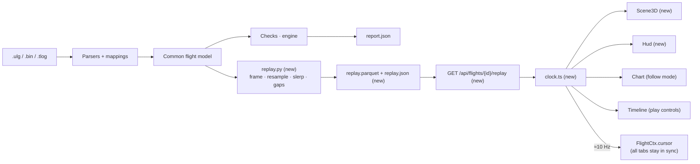

# Replay & Debrief: integration plan

This is the working plan for adding mission **replay** and **debrief** to
FlightLens. The design is the document *FlightLens Replay & Debrief —
Integration Plan* (25 pages, 23 Nov 2026); this file turns it into tasks we
build and tick off, checked against the code as it is today. When the two
disagree, this file wins and says why (section 3).

**How to use it:** work through section 5 release by release, top to bottom.
Tick a task (`- [x]`) in the same commit that completes it. A release is done
when its gate is ticked. Changes to the plan go in this file, with a line in
the change log at the bottom.

## 1. Goal and scope

Replay and debrief become part of FlightLens, not a separate app: a **Replay**
tab on the flight page and a **Debrief** layer on top of findings and reviews.
They reuse the parsers, the common signal vocabulary, the Parquet signal store,
the shared time cursor, the timeline, reviews and the report, so PX4, ArduPilot
and telemetry logs all replay the same way.

| Release | The user gets |
|---|---|
| **1.1 Replay** | Press play on any analyzed flight: a 3D aircraft flies the real path with the real attitude; HUD, charts, timeline and 2D track follow one clock. "Replay from here" on every finding and event. |
| **1.2 Video** | Attach the flight's video, sync it once, and it plays in step with the log. |
| **1.3 Debrief** | Time-stamped notes during playback, a debrief summary and conclusion per flight, and a printable debrief report next to the health report. |
| **1.4 Incident and compare** | Open a crash or problem straight into the critical minute with its likely causes; replay two flights together. |

**Out of scope:** live telemetry (a different product); maps and terrain
until the optional local layer after 1.4; anything that sends data off the
machine.

**Prerequisite:** FlightLens **1.0.0 is released first** (CI green, PyPI and
GHCR published). Replay work happens on `feature/replay` and merges after the
1.0.0 tag.

## 2. Ground rules carried over from 1.0

Each promise FlightLens makes stays true; this is how replay keeps it.

| Promise | How replay keeps it |
|---|---|
| Everything runs locally | No map, terrain, font or CDN servers; three.js is bundled by Vite; 3D works with no network. |
| Strict Content-Security-Policy (`spa_csp()` in `api.py`) | No `eval`, no remote scripts; CSP changes only as listed in section 3 and tested in `tests/test_release.py`. |
| One signal vocabulary | Replay reads common signals only; firmware names stay in `parsers/mappings/*.yaml`. |
| Missing data is *not evaluated*, never OK | No position: attitude-only view with a note. No attitude: level model with a note. Missing HUD values show a dash, never 0. |
| Originals unchanged, SHA-256 recorded | Videos stored as uploaded with their SHA-256; any re-encoded copy is a separate file. |
| Upload isolation and limits | Video uploads are streamed to disk with their own size limit and the same 503 (queue) and 507 (disk) refusals, before the body is read. |
| Traceability, outdated marking | The replay artifact has a version; a change marks older flights outdated, re-analyzed in one click. |
| Read-only demo mode | Replay and video playback work; notes, sync edits, uploads and debrief edits are refused. |
| Themes and accessibility | 3D scene and HUD use the theme tokens; play controls are keyboard-operable with ARIA labels. |
| Telemetry logs are low-rate with dropouts | Interpolate only across gaps of 1 s or less; longer gaps are shown, never smoothed over. |

## 3. Verified against the code: corrections to the design

Checked on 23 Nov 2026 against `main` (`11a223c`).

| Design assumption | What the code has | What we do |
|---|---|---|
| Replay artifact gets "its own version" in provenance | `provenance.py` tracks only check versions and the mapping version (`current_versions`, `versions_of`, `stale_reasons`); there is no artifact version | Add `REPLAY_VERSION` in `replay.py`; `worker.process_log` writes it into the report's `source.artifacts.replay`; `versions_of` reads it; `stale_reasons` adds "replay x → y" (and "replay missing" for analyses made before 1.1). |
| A range-aware streaming response may be needed | Starlette's `FileResponse` (Starlette 1.0, installed) already answers `Range` with 206 | Use `FileResponse`; still test 206, bytes and `Content-Range`. |
| CSP needs `media-src 'self'` | `spa_csp()` sets `default-src 'self'`, which already allows same-origin `<video>` | No change for video. Add `blob:` to `img-src`/`media-src` only when snapshots or clip export need it, and `worker-src 'self'` only if a Web Worker is added. |
| Playwright is "already a dev dependency" for e2e | It is the **Python** package (`pyproject.toml` dev group); no test uses it, and CI installs no browser | E2E tests are pytest + Playwright sync API against `create_app` on a seeded demo library; CI gains `uv run playwright install --with-deps chromium`. vitest is a new web dev dependency. |
| Video uploads get the existing refusals | `RequestGuard` checks size and calls `upload_refusal` only for `POST /api/logs` | Generalize the guard to a table of upload routes with their own limit (`MAX_VIDEO_BYTES`, default 4 GB), reusing `upload_refusal`; do not copy the logic. |
| Emit `att.q0..q3` in four parsers | `ulog.py` already reads `vehicle_attitude.q[0..3]` (to compute Euler); ArduPilot `ATT` and MAVLink `ATTITUDE` are Euler only | Add `att.q0..q3` in `ulog.py` only. `replay.py` derives quaternions from Euler when they are absent: one tested function, not three parser changes. |
| Chart needs an external cursor | `Chart.tsx` already takes `marker` and `onPick` | Only add a *follow* mode (the x-window moves with the clock). |
| Frame origin is "the take-off point, same as TrackView" | `TrackView` centres on the **first track point**, not the take-off point | `replay.json` defines the origin (first take-off from `summarize().sorties`, else the first valid position). The mini-map takes the origin from `replay.json`, so 2D and 3D agree. One projection formula (equirectangular with `cos(lat0)`, R = 6 371 000 m), tested in Python and TypeScript against the same points. |
| Migrations 6 and 7 | `schema.SCHEMA_VERSION` is 5 (5 = job attempts) | Matches: 6 = videos (1.2), 7 = notes and debriefs (1.3), in the `schema.MIGRATIONS` style (idempotent, safety copy). |
| Backup "includes videos" | `backup.py` validates every manifest entry (`FLIGHT_ID`, `ORIGINAL`) and refuses unknown names | Manifest gains a `videos` list with SHA-256; name rule `flights/<id>/videos/<video_id>.(mp4|webm)`; `FORMAT_VERSION` 2; version-1 backups still restore. |
| Prune keeps debriefed flights | `retention.candidates(keep_reviewed=True)` keeps only flights with reviews (`store.review_counts()`) | Keep flights with reviews, notes or a debrief. |
| Lazy route | No `React.lazy` in the app yet | First lazy route; check that Vite splits `three` into its own chunk. |
| Analysis artifacts | `worker.process_log` already writes `tuning.json` and `spectrum.json` in `analysis.tmp`, then swaps it into place | `replay.parquet` + `replay.json` use the same atomic swap. |
| 1.0.0 ships first | 1.0.0 is pushed but not released; CI not yet verified; nothing on PyPI | Release 1.0.0 before merging any replay work. |

## 4. Architecture after integration



The replay builder runs in the same isolated worker process as the checks
(`worker.process_log`), so a damaged log still cannot take the server down.
Checks and the engine do not change.

### Replay artifact

One table resampled to a uniform grid: 25 Hz for `.ulg` and `.bin`, the
native rate (at most 10 Hz) for `.tlog`.

| Column | From | Notes |
|---|---|---|
| `t` | uniform grid | seconds since log start, same clock as every signal |
| `east`, `north`, `up` | `pos.lat/lon/rel_alt` (fallback `gps.lat/lon/alt`) | metres from the origin in `replay.json` |
| `alt_amsl` | `pos.alt` / `gps.alt` | HUD only; NaN when absent |
| `qw`, `qx`, `qy`, `qz` | `att.q0..q3`, else from `att.roll/pitch/yaw` | normalized, slerped |
| `roll`, `pitch`, `yaw` | `att.*` | degrees; yaw unwrapped before resampling, wrapped for display |
| `vn`, `ve`, `climb`, `ground_speed` | `pos.vx/vy/climb` | m/s |
| `airspeed` | `airspeed` | fixed wing, VTOL |
| `thrust`, `motor_1..8` | `ctrl.thrust`, `mot.N` | 0..1 |
| `bat_volt`, `bat_remaining` | `bat.volt`, `bat.remaining` | |
| `mode_index` | mode events | index into `modes` in `replay.json` |
| `valid_pos`, `valid_att` | data availability | false inside gaps longer than 1 s |

`replay.json`: origin (`lat0`, `lon0`, `alt0`, how it was chosen), rate,
extents, `modes`, available columns, `replay_version`, and the source of each
column (estimated position or GPS, quaternion or Euler).

## 5. Release plans

Each task names its files, what it reuses, and how it is accepted. Run the
usual checks after every task: `uv run ruff check . && uv run ruff format
--check . && uv run mypy && uv run pytest`, and `cd web && npm run build` for
frontend tasks.

### 1.1 Replay (branch `feature/replay`)

- [x] **Spec first.** Write `docs/replay.md` (*new*): what the user sees, controls, keyboard shortcuts, what missing data looks like. *Accept:* reviewed by the user before code starts.
- [x] **Quaternions.** `parsers/ulog.py`: emit `att.q0..q3` from `vehicle_attitude.q`; bump `px4.yaml` version. *Accept:* a test in `tests/test_ulog.py` shows the quaternion and Euler signals agree on the sample logs.
- [x] **Frame and attitude core.** `replay.py` (*new*): `local_frame(lat, lon, alt, origin)`, `euler_to_quat`, `slerp`, `unwrap_yaw`. *Accept:* `tests/test_replay_frame.py`: points 100 m east and north land within 0.1 m; `tests/test_replay_attitude.py`: level, 30° roll, 45° pitch, 90° yaw round-trip, and slerp halfway between known attitudes.
- [x] **Resampling.** `replay.build_replay(flight) -> (table, meta)`: uniform grid, linear for position and speeds, slerp for attitude, no interpolation across gaps over 1 s, `valid_*` flags, origin from `summary.summarize(flight).sorties`. *Accept:* `tests/test_replay_resample.py` (hypothesis): times uniform and inside the log; never bridges a gap over 1 s; yaw 359° → 1° never passes 180°.
- [x] **Known-manoeuvre flight.** `flightlens.sim` gains a scripted flight with exact ground truth: a 30° roll held 5 s, a 45° pitch, a 90° yaw turn and a 20 m square at 15 m, written as ArduPilot `.bin` (Euler) and telemetry `.tlog`. *Accept:* `tests/test_replay_known.py`: the built replay matches the script within 0.5° and 0.5 m at every sample, for both formats.
- [x] **Worker and provenance.** `worker.process_log`: write `replay.parquet` and `replay.json` in `analysis.tmp`, with `source.artifacts.replay`; `provenance.versions_of` and `stale_reasons` handle it. *Accept:* `tests/test_replay_formats.py`: a PX4 sample, a generated ArduPilot log (`flightlens.sim.benchmark.copter`) and a tlog (`flightlens.sim.telemetry`) all produce a replay; a log without position gives attitude-only metadata; an old report shows "replay missing" as outdated.
- [x] **API.** `store.read_replay()`; `GET /api/flights/{id}/replay` returns `replay.json` plus the table as columnar JSON (Arrow IPC only if the budget in section 8 demands it). *Accept:* `tests/test_api_replay.py`: 409 before analysis, 200 after; payload within budget for a 1-hour flight.
- [x] **CLI.** `flightlens replay-info <log>` prints coverage (duration, rate, position and attitude source, gaps). *Accept:* a test in `tests/test_cli.py`.
- [x] **Benchmark.** `scripts/benchmark.py` reports replay build time and payload size. *Accept:* numbers in `docs/validation.md`.
- [ ] **Playback clock.** `web/src/components/clock.ts` (*new*): time, playing, rate 0.25×–16×, loop range; one `requestAnimationFrame` loop; subscribed with `useSyncExternalStore`; pushes `FlightCtx.setCursor` at most about 10 Hz. Add vitest. *Accept:* vitest tests for rate, loop, end and the throttle.
- [ ] **Timeline controls.** `components/Timeline.tsx`: play/pause, speed, keyboard (space, J/K/L, arrows with Shift, `,`/`.`, Home/End), shift-drag loop range. *Accept:* existing timeline behaviour unchanged; new keys covered by e2e.
- [ ] **3D scene.** `components/Scene3D.tsx` (*new*), with `three` and `@types/three` pinned: ENU → three.js axes in one tested function; ground grid with scale labels; take-off marker; path in one `BufferGeometry` with the flown part highlighted; finding windows coloured by severity; shadow line to the ground; aircraft meshes built in code per vehicle type (quad, hexa, octo, fixed wing, VTOL); chase, orbit, top-down and cockpit cameras; render only on change. *Accept:* vitest for the axis conversion; attitude-only view when there is no position.
- [ ] **HUD.** `components/Hud.tsx` (*new*), SVG and theme-aware: horizon, heading tape, altitude and speed tapes (airspeed when present), climb, mode, battery, GPS, armed state; a dash for missing values. *Accept:* screenshot tests at level, 30° bank and inverted.
- [ ] **Mini-map and charts.** `TrackView.tsx`: optional origin prop and heading arrow (the mini-map uses `replay.json`'s origin); `Chart.tsx`: follow mode. *Accept:* existing Overview and Signals unchanged.
- [ ] **Replay view.** `pages/ReplayView.tsx` (*new*): the grid layout from the design with hideable panels; `?t=` opens at a time; lazy route in `App.tsx`; Replay tab in `FlightPage.tsx`; "Replay from here" on findings (`Overview.tsx`) and events (`EventsView.tsx`), a few seconds before. *Accept:* the main bundle does not grow (three.js in its own chunk).
- [ ] **E2E.** `tests/test_e2e_replay.py` (*new*, Python Playwright): open Replay on a demo flight; play advances time; space pauses; a finding link jumps to its start minus the lead time; `?t=` opens at the right time; theme switch; read-only mode. CI installs Chromium. *Accept:* green in CI.
- [ ] **Docs and demo.** Demo flights replay well (`demo.py`); README feature list and screenshots; CHANGELOG `[1.1.0]`.

**Gate 1.1:**

- [ ] a replay artifact for every analyzed flight; older flights marked outdated
- [ ] `att.q0..q3` for PX4; quaternions derived for ArduPilot and tlog
- [ ] Replay tab with 3D, HUD, mini-map, synced charts, play controls, keyboard shortcuts, `?t=` links, "Replay from here"
- [ ] offline, both themes, read-only; CSP unchanged
- [ ] frame, attitude, resampling and e2e tests pass
- [ ] performance budget met; main bundle unchanged
- [ ] full suite, benchmark, and `flightlens validate private-logs` (92 of 92) still pass; tag `v1.1.0`

### 1.2 Video (branch `feature/video`)

- [ ] **Migration 6.** `videos` table (section 6) in `schema.MIGRATIONS`. *Accept:* migrating a copy of a real library from 5 to 6 keeps every row, with a safety copy (extend `tests/test_data_safety.py`).
- [ ] **Upload guard.** Generalize `RequestGuard`'s upload rule to a route table (`/api/logs`: 1 GB; `/api/flights/{id}/videos`: `MAX_VIDEO_BYTES`), both through `upload_refusal`. *Accept:* the existing upload tests pass; the video route refuses oversize, queue-full and low-disk uploads before reading.
- [ ] **Media module.** `media.py` (*new*): streamed upload with SHA-256 while writing, MP4 (H.264/AAC) and WebM only, `ffprobe` metadata when available (duration, size, codec, creation time); `ffmpeg` and `ffprobe` added to the `Dockerfile`. *Accept:* `tests/test_videos.py` with a tiny generated clip.
- [ ] **Video API.** `POST/GET /api/flights/{id}/videos`, `GET /api/videos/{video_id}/file` (`FileResponse`, Range), `PATCH`, `DELETE`. *Accept:* 206 with correct bytes and `Content-Range`; read-only refusal; deleting the flight removes its videos.
- [ ] **Video panel.** `components/VideoPanel.tsx` (*new*): follows the clock (native playback at the clock rate; correct when drift > 100 ms, checked every 500 ms); seeks while scrubbing; "no video at this time" state; picker for several videos.
- [ ] **Sync tools.** Nudge (±1 s, ±0.1 s, ±1 frame); sync points with offset fit (one point) and offset + rate fit (two or more); creation-time first guess labelled as a guess; method and accuracy shown on the panel. *Accept:* vitest for the fit.
- [ ] **Timeline coverage.** Video coverage bar on `Timeline.tsx`.
- [ ] **Backup, restore and prune.** Videos in the backup manifest with SHA-256, `--no-video`, `FORMAT_VERSION` 2 with version 1 still restoring; `retention` counts video size. *Accept:* round trip with and without videos; damaged video refused.
- [ ] **Sync validation with a generated video.** A test helper writes a short WebM/MP4 for the known-manoeuvre flight: a frame counter and a full-screen flash at known log times (take-off, the sharp turn, landing), with a deliberate offset and a 0.1% clock drift. *Accept:* after a two-point sync, every flash lines up with its log time within 100 ms (one frame at 25 fps is 40 ms); one-point sync recovers the offset; results in `docs/validation.md`.

**Gate 1.2:**

- [ ] upload, list and delete videos; Range streaming; size and disk refusals
- [ ] nudge and sync points; drift fit with two or more points
- [ ] video follows play, pause, rate and scrubbing; coverage bar
- [ ] backup and restore with and without videos; Docker image has `ffprobe`
- [ ] generated-video sync within 100 ms; full suite and real-log validation pass; tag `v1.2.0`

### 1.3 Debrief (branch `feature/debrief`)

- [ ] **Migration 7.** `notes` and `debriefs` tables. *Accept:* migrating a copy of a real library from 6 to 7 keeps every row.
- [ ] **Notes API.** `GET/POST /api/flights/{id}/notes`, `PATCH/DELETE /api/notes/{note_id}`; text and tag limits like `reviews.NOTE_MAX`. *Accept:* `tests/test_notes_debrief.py`: CRUD, cross-site and host checks, read-only refusal, cascade on flight delete.
- [ ] **Notes panel.** `components/NotesPanel.tsx` (*new*): add with N at the cursor, range by shift-drag, starter tags plus free tags; each note stores the camera view and restores it; markers on the timeline and the 3D path; edit and delete inline.
- [ ] **Debrief.** `GET/PUT /api/flights/{id}/debrief`; `pages/DebriefView.tsx` (*new*): status (open/closed), summary, conclusion, actions, author (a free-text name remembered by the browser); a "Debriefed" badge and filter in `Library.tsx`; a column on the Aircraft page.
- [ ] **Debrief report.** `debrief.py` (*new*) and `templates/debrief.html.j2` (*new*), in the style of `htmlreport.py`: flight facts and verdict; debrief text; one chronological timeline of modes, events, findings (with review status) and notes; a server-side SVG track with note and finding locations; provenance (FlightLens version, log and video SHA-256, sync method). Optional view snapshots captured in the browser. `GET /api/flights/{id}/debrief.html`. *Accept:* prints cleanly; CSP like the health report.
- [ ] **Prune and backup.** Notes and debriefs always in backups; flights with notes or a debrief are kept by `prune`.

**Gate 1.3:**

- [ ] migration 7 tested on a real library copy
- [ ] notes: add, range, tags, edit, delete, restore view; markers on the timeline and path
- [ ] debrief summary and status; Library badge and filter; prune keeps debriefed flights
- [ ] `debrief.html` prints with provenance; read-only mode blocks every note and debrief edit
- [ ] full suite and real-log validation pass; tag `v1.3.0`

### 1.4 Incident mode and compare (branch `feature/incident`)

- [ ] **Incident mode.** From a `flight.crash` or Problem finding: open the replay 60 s before, list the finding's `related` causes in time order (built by `engine._link_causes`), loop the critical window, and pre-fill a debrief.
- [ ] **Replay compare.** Two flights in one scene with synced charts, aligned at take-off (as `pages/Compare.tsx` does) or at a chosen event.
- [ ] **Real-log validation.** Replay the real ArduPlane crash logs and a few public PX4 logs; check the crash moment, attitude and path by eye; record the results in `docs/real-log-results.md`.

**Gate 1.4:**

- [ ] incident mode opens 60 s before the crash or problem and lists the related causes in order
- [ ] two flights replay together, aligned at take-off or a chosen event
- [ ] validated on the real crash logs and documented; tag `v1.4.0`

### Later (not scheduled)

VTOL transition events (`vtol_vehicle_status`, ArduPilot `QTUN`); camera
trigger events for video sync (`camera_capture`, `CAM`); clip export with
`MediaRecorder`; an optional local map and terrain layer from user-provided
files (MBTiles, GeoTIFF), off by default; camera footprint from gimbal
attitude; frame-accurate sync from KLV (MISB ST 0601); planned versus flown
paths from a `.plan` file or mission items.

## 6. API and schema reference

Every write endpoint follows the existing rules: refused in read-only mode,
cross-site writes refused, host allow-list enforced.

| Release | Method and path | Purpose |
|---|---|---|
| 1.1 | `GET /api/flights/{id}/replay` | metadata and the replay table |
| 1.2 | `POST /api/flights/{id}/videos` | upload a video (streamed, size-limited) |
| 1.2 | `GET /api/flights/{id}/videos` | list videos with offset and sync method |
| 1.2 | `GET /api/videos/{video_id}/file` | the video, with HTTP Range |
| 1.2 | `PATCH /api/videos/{video_id}` | offset, sync points, label |
| 1.2 | `DELETE /api/videos/{video_id}` | remove a video |
| 1.3 | `GET, POST /api/flights/{id}/notes` | list or add notes |
| 1.3 | `PATCH, DELETE /api/notes/{note_id}` | edit or remove a note |
| 1.3 | `GET, PUT /api/flights/{id}/debrief` | debrief status, summary, conclusion, actions |
| 1.3 | `GET /api/flights/{id}/debrief.html` | printable debrief report |

Migration 6 (videos) and 7 (notes, debriefs), in the idempotent style of
`schema.py`:

```sql
-- 6: videos
CREATE TABLE IF NOT EXISTS videos (
    id               TEXT PRIMARY KEY,
    flight_id        TEXT NOT NULL REFERENCES flights(id) ON DELETE CASCADE,
    filename         TEXT NOT NULL,
    sha256           TEXT NOT NULL,
    size_bytes       INTEGER,
    duration_s       REAL,
    width            INTEGER,
    height           INTEGER,
    codec            TEXT,
    created_at_media TEXT,        -- container creation time, if any
    offset_s         REAL,        -- log time = video time + offset_s
    rate             REAL,        -- clock-rate correction from 2+ sync points (1.0 = none)
    sync_method      TEXT,        -- none | metadata | manual | points | camera_trigger | klv
    sync_points      TEXT,        -- JSON [[video_t, log_t], ...]
    label            TEXT,
    uploaded_at      REAL NOT NULL
);

-- 7: notes and debriefs
CREATE TABLE IF NOT EXISTS notes (
    id          TEXT PRIMARY KEY,
    flight_id   TEXT NOT NULL REFERENCES flights(id) ON DELETE CASCADE,
    t_start     REAL NOT NULL,
    t_end       REAL,
    text        TEXT NOT NULL,
    tags        TEXT,             -- JSON list
    view        TEXT,             -- JSON camera mode and pose, restored on click
    snapshot    TEXT,             -- file name of an optional view snapshot
    author      TEXT,
    created_at  REAL NOT NULL,
    updated_at  REAL NOT NULL
);
CREATE TABLE IF NOT EXISTS debriefs (
    flight_id   TEXT PRIMARY KEY REFERENCES flights(id) ON DELETE CASCADE,
    status      TEXT NOT NULL,    -- open | closed
    summary     TEXT,
    conclusion  TEXT,
    actions     TEXT,             -- JSON list
    author      TEXT,
    updated_at  REAL NOT NULL
);
```

Compared with the design: `rate` makes the two-point drift fit storable, and
notes store `view` and `snapshot`, which the design's features need.

Files: `flights/<id>/analysis/replay.parquet` and `replay.json` (rebuilt with
every analysis); `flights/<id>/videos/<video_id>.<ext>` (original, read-only);
`flights/<id>/snapshots/<note_id>.png` (optional).

## 7. Testing and validation

The riskiest errors are silent ones, such as a 2° attitude error or a 300 ms
video offset, so they get the most tests.

| Kind | What | Reuses |
|---|---|---|
| Unit | frame projection, Euler ↔ quaternion, slerp, yaw unwrap | `make_flight` in `tests/conftest.py` |
| Property | resampling never bridges gaps, uniform times, yaw continuity | hypothesis (already used in `tests/test_fuzz.py`) |
| Format | replay from PX4, ArduPilot and tlog | `testdata/logs/`, `flightlens.sim.benchmark.copter`, `flightlens.sim.telemetry` |
| API | replay, videos (Range), notes, debrief; read-only and cross-site | `TestClient` fixtures as in `tests/test_api.py` |
| Data safety | migrations 6 and 7, backup v2, prune rules | `tests/test_data_safety.py` |
| Web logic | clock, sync fit, axis conversion | vitest (*new*) |
| End to end | replay flows and keyboard | Python Playwright on `demo.seed` |
| Visual | HUD at fixed attitudes | Playwright screenshots |
| Known outcome | generated known-manoeuvre flight (30° roll held 5 s, a 20 m square) within 0.5° and 0.5 m; generated video synced within 100 ms | `flightlens.sim` (exact ground truth, no simulator needed) |
| Optional extra | a physics-based SITL flight with a scripted mission and a screen recording, when ArduPilot or PX4 SITL is available; not required by any gate | `scripts/sitl_campaign.py` |
| Real logs | crash moment, attitude and path by eye | real ArduPlane logs, public PX4 logs |

## 8. Performance budget

| Measure | Budget | Measured by |
|---|---|---|
| Replay build, 1-hour `.ulg` | under 5 s on top of analysis | `scripts/benchmark.py` |
| Replay payload, 1-hour flight | under 5 MB compressed | `tests/test_api_replay.py` |
| Replay tab first load (cached) | under 2 s to the first frame | Playwright timing |
| Playback | 60 fps with 3D, HUD and 3 charts on a mid-range laptop | manual, recorded in the release notes |
| Seek | under 100 ms (log), under 300 ms (video) | Playwright timing |
| Main bundle | no growth without opening Replay | a CI check comparing the built chunk sizes |

## 9. Risks and mitigations

| Risk | Impact | Mitigation |
|---|---|---|
| Frame or attitude conversion error (mirrored roll, sideways flight) | wrong conclusions | one conversion function each side, known-attitude tests, HUD screenshots, the generated known-manoeuvre flight |
| Altitude reference mix-up (AMSL, relative, ellipsoid) | aircraft underground or floating | 3D uses altitude relative to take-off; the HUD labels which altitude it shows |
| Smoothing over dropouts | missed evidence | no interpolation across gaps over 1 s; gaps shown on the timeline and path |
| Plausible but wrong video offset | false cause and effect | sync method and accuracy shown on the panel and in the debrief report; creation time labelled as a guess |
| Large videos fill the disk | uploads of logs refused | own size limit, 507 refusal, `--no-video` backups, prune counts video size |
| three.js slows the analyzer for everyone | slower app | lazy route; CI bundle check |
| 60 fps re-renders the whole flight page | stutter | external clock store; `FlightCtx.cursor` throttled to about 10 Hz |
| CSP regression while adding media or workers | blocked features or a weaker policy | every CSP change listed in section 3 and asserted in `tests/test_release.py` |
| Playwright browsers in CI | flaky or slow CI | Chromium only, cached; e2e in its own CI job |
| Scope creep toward a map or GIS tool | releases slip | maps and terrain only after 1.4, optional, from local files |
| Low-rate `.tlog` makes jerky replays | poor experience | interpolate within short gaps, show the real rate in the HUD, say so in `docs/replay.md` |

## 10. Working agreement

- One task per commit where possible; tick it in that commit.
- Every release ends with: CHANGELOG entry, docs, `scripts/benchmark.py`,
  `flightlens validate private-logs` (92 of 92), the full suite, and the gate
  ticked. Then tag.
- Never commit private or company logs or videos (`CONTRIBUTING.md`); test
  videos are generated.
- When the plan changes, edit this file and add a line below.

## Change log

- 2026-11-23: plan created from the design document and checked against
  `main` at `11a223c`.
- 2026-11-24: the replay table is served as `GET /api/flights/{id}/replay.bin`
  (gzip-compressed float32 columns, decoded with `Float32Array`) next to the
  JSON metadata at `/replay`: columnar JSON would be several times the 5 MB
  budget for a 1-hour flight; the binary table is about 3 MB.
- 2026-11-23: SITL is no longer required. Known-outcome checks use a
  generated known-manoeuvre flight (exact ground truth) and a generated sync
  video; SITL stays as optional extra validation.
